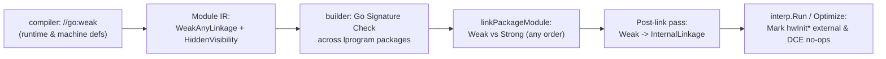
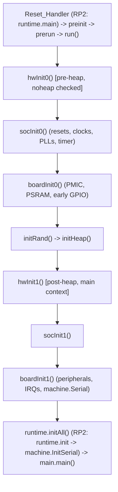

# SDD Spec: Out-of-Tree Board Packages

## Metadata
* **Status:** `IMPLEMENTING`
* **Author:** Konstantin Sharlaimov
* **Created:** 2026-11-15
* **Last Updated:** 2026-11-15
* **Approver:** Konstantin Sharlaimov

---

## Phase 1: Proposal (Rough Idea)

### 1.1 Problem Statement
TinyGo currently couples SoC hardware abstraction with PCB-specific board definitions inside GOROOT (`src/machine/board_*.go` and `targets/*.json`). Pre-instantiated peripheral globals (`UART0`, `I2C0`, `SPI0`, `PWM0`, default pin constants, board IRQ registrations, USB VID/PID constants, and crystal frequency constants) are compiled directly into `package machine`, while chip clock initialization runs inside `runtime.init()` during Go package initialization rather than before heap and package `init()` execution.

Engineers building custom or proprietary PCBs on supported microcontrollers cannot define board pinouts, crystal frequencies, early power/memory setup, or peripheral instances inside their own Go module; they must either upstream niche boards into TinyGo, maintain a compiler fork, or symlink files into `$TINYGOROOT/src/machine`. Meanwhile, TinyGo maintainers carry a growing maintenance burden of hundreds of in-tree board files (see [tinygo-org/tinygo#3362](https://github.com/tinygo-org/tinygo/issues/3362)).

Doing nothing blocks commercial TinyGo adoption on custom hardware, forces fragile GOROOT mutations across toolchain upgrades, wastes RAM and interrupt vectors on unrouted peripherals, and leaves `src/machine` unscalable as board count grows.

### 1.2 Proposed Solution
Separate chip-level support in GOROOT (`runtime` and `machine`) from board-level support in ordinary out-of-tree Go packages paired with an external `target.json` that inherits a chip target:

1. **Two-stage boot hooks in `runtime`:** Split hardware startup in `runtime.run()` across all schedulers into an early pre-heap stage (SoC resets/clocks/timers followed by early board power/memory bring-up) and a post-heap pre-`initAll` stage (late SoC init followed by board peripheral setup, IRQ binding, and serial console assignment), without modifying architecture startup assembly.
2. **Compiler, linker, and partial-evaluator support:** Add a restricted weak-definition pragma for `runtime` and `machine` with order-independent LTO symbol resolution, cross-package Go signature verification, and post-link internalization so unused hooks compile away at `-opt=1` and above. Teach the compile-time partial evaluator (`interp`) that pre-`initAll` hooks mutate globals at runtime, and enforce at compile time that the pre-heap stage performs no escaping heap allocations.
3. **MCU-agnostic `boardpackage` mode in `package machine`:** When a target sets `"board-package"` (which automatically enables the `boardpackage` build tag and auto-imports the board package into the root package) or sets the `boardpackage` build tag directly, keep CPU-internal blocks (`Watchdog`, `Flash`, RNG) and peripheral controller types (`UART`, `I2C`, `SPI`, `PWM`) in `package machine`, omit pin-muxed global peripheral instances and default pin assumptions, and expose cross-MCU linkname hooks for board crystal oscillators and USB descriptor identity (required only when USB descriptors are used).
4. **External target asset resolution and RP2 reference migration:** Resolve relative linker scripts, extra files, and inherited target specs relative to an external `target.json` directory, and migrate RP2 (`rp2040`, `rp2350`, `rp2350b`) as the first supported SoC family while keeping all existing in-tree boards unchanged.

### 1.3 Scope & Requirements
* **In Scope:**
  * Two-stage `runtime.run()` hardware init hooks across `tasks`, `asyncify`, `cores`, `none`, and `threads` schedulers, gated by `socinit` with zero codegen overhead when disabled at `-opt=1` and above.
  * Restricted weak-function pragma in `runtime` and `machine`, cross-package Go signature validation, order-independent LTO weak/strong linking, duplicate-strong rejection, and post-link internalization.
  * `interp` protection preventing compile-time folding of globals touched by pre-`initAll` hardware hooks.
  * Compile-time check rejecting escaping heap allocations reachable from the pre-heap init stage.
  * Resolution of relative `linkerscript`, `extra-files`, and `.json` `inherits` paths against the directory of an external `target.json`, plus a `"board-package"` field in `target.json` that automatically adds the `boardpackage` build tag and auto-imports the board package into the root package.
  * `boardpackage` build-tag mode in `package machine`: board crystal hook (high-speed crystal Hz), conditional USB identity hook, deferred `machine.Serial` UART binding, suppression of pin-muxed global peripheral instances (`UART*`, `I2C*`, `SPI*`, `PWM*`, board analog pin aliases), retention of CPU-internal blocks (`Watchdog`, `Flash`, `GetRNG`), and exported controller types/constructors (including `PWM` and `UART.HandleInterrupt` on RP2).
  * Reference migration of `rp2040`, `rp2350`, and `rp2350b` targets (including selecting system PLL, USB PLL, XOSC delay, and tick dividers from the board crystal hook, limited to a fixed set of supported crystals) with zero regressions on existing in-tree RP2 boards.
  * Unit and integration tests across `compiler`, `builder`, `interp`, `transform`, `compileopts`, `loader`, `runtime`, and `machine`.
* **Out of Scope:**
  * Migrating non-RP2 MCU families (STM32, nRF52, ATSAMD, ESP32, NXP, AVR, RISC-V) to `socinit` and `boardpackage` mode (deferred to per-family follow-up specs).
  * Migrating existing in-tree `src/machine/board_*.go` and `targets/*.json` definitions to `src/boards/` (backwards-compatible in-tree board packages) or moving new boards to external repositories (e.g., `tinygo.org/x/boards`).
  * Out-of-tree replacement of `package machine` itself for unsupported SoCs.
  * Modifying architecture-specific `Reset_Handler` or startup `.s` assembly files.
  * Boot hooks on the wasm entry path (`src/runtime/runtime_wasmentry.go`), which does not go through `run()`.
  * Dynamic runtime clock reconfiguration after boot.
  * Arbitrary crystal frequencies or CPU clocks. Only the combinations in the compile-time PLL table are supported (today 12 MHz, with 200 MHz on RP2040 and 150 MHz on RP2350).
  * Oscillator bypass and low-speed crystal hooks (`boardXTALBypass`, `boardLSE`). They arrive with the first family that consumes them.

---

## Phase 2: System Design (SDD)

### 2.1 Architecture & Components

Out-of-tree board support splits responsibilities across four layers without altering Go's module resolution or architecture startup assembly (`Reset_Handler`):

1. **Compiler & LTO Linker (`compiler/`, `builder/`, `transform/`):**
   - `//go:weak` pragma (restricted to function definitions in `runtime` and `machine`) emits `llvm.WeakAnyLinkage` with `HiddenVisibility` for non-exported functions.
   - `builder.Build` validates Go `*types.Signature` identity across `lprogram.Sorted()` before `ssa.Program` is freed (preventing opaque-pointer type aliasing bugs). The check covers only definitions whose linkname overrides a `//go:weak` function or supplies a bodyless declaration in `runtime` or `machine`. Other linknames stay unchecked, since stdlib linknames mismatch signatures on purpose.
   - `linkPackageModule` resolves weak vs. strong definitions in any package order, rejects duplicate weak definitions or duplicate strong overrides of a weak hook, and preserves `LinkOnceODRLinkage` fallback only for non-weak stdlib collisions. Today it demotes every later duplicate to `LinkOnceODRLinkage`, which would discard a strong override linked after its weak default.
   - Post-link internalization reuses the existing hidden-visibility loop in `builder/build.go` and extends it so every surviving `WeakAnyLinkage` function becomes `InternalLinkage` + `DefaultVisibility`, allowing `PrepareRuntimeStartup` and `Optimize` (`-opt=1+`) to inline constants and dead-strip empty hooks.
   - Compile-time `noheap` enforcement applies `funcNoHeap` by link name to `runtime.hwInit0`, `runtime.socInit0`, and `runtime.boardInit0` (so a board override needs no pragma), and adds a pass after `OptimizeAllocs` (`transform/noheap_init.go`) verifying `runtime.alloc*` is transitively unreachable from `runtime.hwInit0`. The walk follows direct calls and reports any indirect call reachable from `hwInit0` as an error. At `-opt=0` `OptimizeAllocs` does not run, so every allocation in the pre-heap stage is rejected, escaping or not, matching existing `//go:noheap` behavior.

2. **Compile-Time Partial Evaluator (`interp/`):**
   - `interp.Run` (whole program) marks `runtime.hwInit0` and `runtime.hwInit1` via `r.markExternalLoad` before interpreting `runtime.initAll`.
   - `interp.RunFunc` (per package, runs first, in `builder/build.go` package jobs) marks any `runtime.socInit*`/`runtime.boardInit*` defined in that package module before interpreting `<pkg>.init`.
   - This prevents `interp` from folding `nil` over globals populated at runtime before `initAll()` (such as board peripheral pointers). `RunFunc` sees one package at a time, so it protects only globals of the package that defines the hook. Accepted limitation: hooks may change other packages only through their exported API, and a package `init` must not read its own globals that a hook writes.

3. **Runtime Two-Stage Boot (`src/runtime/`):**
   - `hwInit0()` runs at the start of `run()` (before `initRand()` and `initHeap()`) on core 0 / system stack with zero heap allocation, calling `socInit0()` then `boardInit0()`.
   - `hwInit1()` runs after `initHeap()`, immediately before `initAll()` in the same context: the main goroutine on `tasks`, `asyncify`, and `cores` (before `startSecondaryCores()`), the main thread on `none` and `threads`. It calls `socInit1()` then `boardInit1()`.
   - Gated by the `socinit` build tag (`hwinit_socinit.go` vs. empty `hwinit_nosocinit.go`).
   - RP2 mapping (`src/runtime/runtime_rp2.go`): `socInit0()` calls `machineInit()` (resets, clocks, timer), `socInit1()` keeps the weak no-op default, and `runtime.init()` keeps `machine.InitSerial()` so in-tree serial setup still runs after `machine.init()` and `machine/usb/cdc.init()`.
   - `putchar`, `getchar`, and `buffered` in `runtime_rp2.go` tolerate a nil `machine.Serial` under `boardpackage` (output dropped), so a `panic` or `println` before `boardInit1()` does not fault.

4. **Target Loader & Machine `boardpackage` Mode (`compileopts/`, `loader/`, `src/machine/`):**
   - `compileopts/target.go` resolves relative `linkerscript`, `extra-files`, and `.json` `inherits` paths against the directory of the external `target.json` that names them. Resolution happens when each spec file is loaded, before `overrideProperties` merges it, so entries from different files keep their own base directory. See 2.3 for the lookup order.
   - `TargetSpec.BoardPackage` (`"board-package"` in `target.json`) names the Go import path of the board package (e.g., `"boards/<name>"` for future migrated in-tree boards under `src/boards/`, or `"tinygo.org/x/boards/<name>"` / `"<module>/boards/<name>"` for external boards). When non-empty, `Config.BuildTags()` automatically appends `"boardpackage"` (if not already present) and `loader` auto-imports `BoardPackage` as a blank import into the root package so its hooks and `init()` enter the build graph without requiring an explicit import in `main`.
   - When `boardpackage` is present in `build-tags`, `package machine` retains CPU-internal blocks (`Watchdog`, `Flash`, `GetRNG`, `InitADC`, `GPIO*`, `RingBuffer`) and peripheral controller types (`UART`, `I2C`, `SPI`, `PWM`), while omitting pin-muxed peripheral globals (`UART0..1`, `I2C0..1`, `SPI0..1`, `PWM0..11`, board `ADC0..n` aliases, `DefaultUART`, and `machine` UART IRQ `init()` registrations).

### 2.2 Data Structures & Interfaces

#### Runtime & Board Linkname Hooks

| Linkname Target | Signature | Linkage in GOROOT | Contract / Units |
| :--- | :--- | :--- | :--- |
| `runtime.socInit0` | `func()` | `//go:weak` (`runtime`, `socinit`) | Pre-heap SoC init (resets, clocks, PLLs, timers). No escaping heap allocs. |
| `runtime.socInit1` | `func()` | `//go:weak` (`runtime`, `socinit`) | Post-heap SoC init before `initAll()`. |
| `runtime.boardInit0` | `func()` | `//go:weak` (`runtime`, `socinit`) | Pre-heap board init (rails, external RAM, early GPIO). No escaping heap allocs. |
| `runtime.boardInit1` | `func()` | `//go:weak` (`runtime`, `socinit`) | Post-heap board init (peripheral structs, IRQs, `machine.Serial`). |
| `machine.boardXTAL` | `func() uint32` | Bodyless decl under `boardpackage` on RP2 (crystal mandatory, missing definition is a link error). Not declared without `boardpackage`. | External high-speed crystal frequency in **Hz**. Must return a constant that matches an entry of the compile-time PLL table (today only `12_000_000`). Any other value panics in `socInit0()`. Called pre-heap. |
| `machine.boardUSBIdentity` | `func() (uint16, uint16, string, string)` | Bodyless decl (`boardpackage`) | Returns `(vid, pid, manufacturer, product)`. Required only when USB descriptors survive `globaldce`. `machine/usb` overrides (`usb.VendorID` etc.) still take precedence. |

All hooks are supplied by a board package through `//go:linkname <local> <target>` on a function with a body. The four `runtime` hooks keep the GOROOT weak no-op default when not overridden.

#### RP2 `package machine` Additions & Decoupling (`boardpackage`)

* **Exported PWM controller (`src/machine/machine_rp2_pwm.go`):**
  * Export `type PWM struct` (with internal `type pwmGroup = PWM` alias for existing code).
  * Export `func NewPWM(slice uint8) *PWM` returning `(*PWM)(unsafe.Add(unsafe.Pointer(rp.PWM), 0x14*uintptr(slice)))`, validating `slice < numPWMSlices` (new const, `8` on RP2040, `12` on RP2350). Zero heap allocation. An out-of-range slice returns `nil` without panicking.
  * The `PWM0..7` globals (`machine_rp2_pwm.go`) and `PWM8..11` (`machine_rp2_2350b.go`) move behind `!boardpackage`.
* **Exported UART IRQ handler (`src/machine/machine_rp2_uart.go`, `machine_rp2.go`):**
  * Export `func (uart *UART) HandleInterrupt(interrupt.Interrupt)`. It replaces the unexported `handleInterrupt`.
  * The `UART0`/`UART1` globals and their `interrupt.New` registration in `machine_rp2.go` `init()` move behind `!boardpackage`. A board package builds `machine.UART{Buffer: machine.NewRingBuffer(), Bus: rp.UART0}` itself and registers `interrupt.New(rp.IRQ_UART0_IRQ, uart.HandleInterrupt)`.
  * Under `boardpackage`, `UART.Configure`, `I2C.Configure`, and `SPI.Configure` require explicit pins (no `UART_TX_PIN`, `I2C0_SCL_PIN`, `SPI0_SCK_PIN` fallbacks) and return an error when none are set.
* **RP2 clock derivation from `boardXTAL()` (`src/machine/machine_rp2_clocks.go`, `machine_rp2_pll.go`, `machine_rp2_xosc.go`, `machine_rp2_2350.go`):**
  * Add `xtalFreqHz() uint32`, the single source of crystal frequency inside `package machine`. Without `boardpackage` it returns the in-tree board constant `xoscFreq * MHz`. Under `boardpackage` it returns `boardXTAL()`. All `xoscFreq` uses (`clocks.init()`, `clkRef` configure, `Watchdog.startTick`, VREG settle delay, `xosc.init()` startup delay, `pll.init()`) switch to it.
  * Keep the `interp`-folded `func init()` PLL precomputation in `machine_rp2_clocks.go`. There is no runtime divider search. Without `boardpackage` it computes `pllSys` dividers for `xoscFreq` and the chip `cpuFreq` exactly as today. Under `boardpackage` it fills a table with one entry per supported crystal (`pllSys` and `pllUSB` dividers for the chip `cpuFreq`), and `clocks.init()` picks the entry matching `xtalFreqHz()` by a linear scan with no allocation. The supported set is a constant list in `machine_rp2_clocks.go`, today `12 MHz` only. Supporting another crystal means adding it to that list.
  * Program `xtalFreqHz() / MHz` into RP2350 `TICKS.TIMER0_CYCLES` instead of hardcoded `12`, and pass it to `Watchdog.startTick` on both chips.
  * Under `boardpackage`, `clocks.init()` panics when `xtalFreqHz()` has no table entry. Every table entry must be a whole multiple of `1 MHz` in `[1 MHz, 15 MHz]` (XOSC range per RP2040 datasheet section 2.16, 1 µs tick needs whole MHz). The panic has no console output and shows as a hang at boot.
* **Serial (`src/machine/serial-uart.go` vs. `serial-uart-boardpackage.go`):**
  * `serial-uart.go` narrows to `baremetal && serial.uart && !boardpackage`.
  * Under `baremetal && serial.uart && boardpackage`: declare `var Serial *UART` (nil until `boardInit1()` assigns it) and no-op `func InitSerial() {}`.
  * `serial.usb`, `serial.rtt`, and `serial.none` are unchanged under `boardpackage`. With `serial.usb`, `InitSerial()` still runs from `runtime.init()` and reads the identity through `boardUSBIdentity()`.
* **USB identity (`src/machine/usb.go`, `usb_identity_board.go`, `usb_identity_boardpackage.go`):**
  * `usbVendorID()`, `usbProductID()`, `usbManufacturer()`, and `usbProduct()` read fallback values through one accessor. Without `boardpackage` it returns the in-tree `usb_VID`, `usb_PID`, `usb_STRING_MANUFACTURER`, `usb_STRING_PRODUCT` constants. Under `boardpackage` it calls `boardUSBIdentity()`.

### 2.3 Protocol / API Changes

* **Build tags:**
  * `socinit`: enables two-stage `hwInit0`/`hwInit1` hooks in `runtime` (added to `targets/rp2040.json` and `targets/rp2350.json`; `targets/rp2350b.json` inherits it). All in-tree RP2 boards therefore boot through `socInit0()`.
  * `boardpackage`: selects custom-board mode in `package machine`. Automatically added by `Config.BuildTags()` whenever `"board-package"` is set in `target.json`, or set explicitly in `"build-tags"`.
* **Target `"board-package"` field (`target.json`):**
  * Optional string import path (`TargetSpec.BoardPackage`). When set, TinyGo adds the `boardpackage` build tag and auto-imports the package into the root package as a blank import (`_ "<board-package>"`), so `boardXTAL`, `boardUSBIdentity`, `boardInit0`/`boardInit1`, and any `init()` enter the link even if user code only imports `"machine"`.
  * Existing built-in targets migrated in the future will live under `src/boards/<name>` (e.g. `"board-package": "boards/pico"`), while new boards live in external Go modules (e.g. `"tinygo.org/x/boards/<name>"` or `"<module>/boards/<name>"`).
* **Compiler pragma:**
  * `//go:weak` allowed only on function definitions in `runtime` and `machine`.
* **External `target.json` path resolution (`compileopts/target.go`):**
  * Applies only to spec files loaded by path (name ends in `.json`). Built-in targets under `TINYGOROOT/targets` keep current behavior.
  * `linkerscript` and `extra-files`: a relative entry that exists under the directory of the spec file naming it becomes an absolute path. Otherwise it stays `TINYGOROOT`-relative as today. Consumers (`Config.LDFlags`, the extra-file jobs in `builder/build.go`) must accept absolute paths without joining `TINYGOROOT`.
  * `inherits`: a relative `.json` entry is looked up under the directory of the spec file naming it first, then relative to the working directory (current behavior). Entries without `.json` still name built-in targets.
  * A file present at both the external and the `TINYGOROOT`-relative location resolves to the external one.
* **Board package import:**
  * Firmware binaries either rely on `"board-package"` in `target.json` (auto-imported into the root package) or import `"<module>/boards/<name>"` directly when using board-exported symbols (pins, `UART0`, etc.).

### 2.4 Real-Time & Resource Impacts

* **Zero overhead when unused:** Targets without `socinit` emit empty `hwInit0()`/`hwInit1()` functions that inline and disappear at `-opt=1+`.
* **Zero overhead for unoverridden weak hooks:** Post-link internalization converts surviving `WeakAnyLinkage` functions to `InternalLinkage`, allowing inlining and dead-code elimination of unused hooks.
* **RAM & IRQ savings under `boardpackage`:** Uninstantiated `UART`, `I2C`, `SPI`, `PWM`, and `RingBuffer` globals are omitted completely, avoiding static `.bss` allocations and unused IRQ vector registrations.
* **Pre-heap safety:** `hwInit0` is compile-time verified to have zero escaping heap allocations (`runtime.alloc*` unreachable). `NewPWM(slice)` performs pointer arithmetic only with zero allocation. Verified by `transform/noheap_init_test.go` and the Task 7 end-to-end build.
* **Boot time and flash:** In-tree RP2 boards keep compile-time PLL dividers, so no boot or `.text` change is expected. Task 5 records the before/after `.text` size for `pico` and `pico2` to confirm. Under `boardpackage` the cost is one table entry (dividers for both PLLs) per supported crystal plus a linear scan at boot.
* **IRQ latency:** unchanged. No hook runs in interrupt context, and `UART.HandleInterrupt` is the existing handler under an exported name.

---

## Phase 3: Implementation Plan (IP)

### 3.1 Task Breakdown

- [x] **Task 1:** Implement `//go:weak` pragma, Go signature validation, order-independent LTO linking, and post-link internalization
  - **Files:** `compiler/symbol.go`, `compiler/compiler.go`, `builder/build.go`, `compiler/testdata/pragma*.go`, `builder/link_test.go`, `builder/weak_test.go`
  - **Verification:** `go test ./compiler/... ./builder/...`
- [ ] **Task 2:** Protect `interp` against pre-`initAll` hook mutations (with a regression test for a hook-assigned `machine.Serial`-style global) and add transitive `hwInit0` no-heap check
  - **Files:** `compiler/symbol.go`, `interp/interp.go`, `interp/interp_test.go`, `interp/testdata/...`, `transform/noheap_init.go`, `transform/noheap_init_test.go`, `transform/testdata/...`, `transform/optimizer.go`
  - **Verification:** `go test ./compiler/... ./interp/... ./transform/...`
- [ ] **Task 3:** Resolve relative `linkerscript`, `extra-files`, and `.json` `inherits` paths for external `target.json`, add `"board-package"` (`TargetSpec.BoardPackage`) with automatic `boardpackage` build tag, and auto-import `BoardPackage` into the root package in `loader`
  - **Files:** `compileopts/target.go`, `compileopts/config.go`, `compileopts/target_test.go`, `compileopts/testdata/...`, `loader/loader.go`, `loader/loader_test.go`, `builder/build.go`
  - **Verification:** `go test ./compileopts/... ./loader/... ./builder/...`
- [ ] **Task 4:** Add two-stage `hwInit0`/`hwInit1` boot hooks across `runtime` schedulers (no target sets `socinit` yet, test passes `-tags=socinit`)
  - **Files:** `src/runtime/hwinit_socinit.go`, `src/runtime/hwinit_nosocinit.go`, `src/runtime/scheduler_cooperative.go`, `src/runtime/scheduler_cores.go`, `src/runtime/scheduler_none.go`, `src/runtime/scheduler_threads.go`, `builder/boothooks_test.go`
  - **Verification:** `go test ./builder/... -run TestBootHooks`
- [ ] **Task 5:** Migrate in-tree RP2 targets (`rp2040`, `rp2350`, `rp2350b`) to `socinit` and route crystal frequency through `xtalFreqHz()`, no `boardpackage` code yet
  - **Files:** `targets/rp2040.json`, `targets/rp2350.json`, `src/runtime/runtime_rp2.go`, `src/machine/machine_rp2_clocks.go`, `src/machine/machine_rp2_xosc.go`, `src/machine/machine_rp2_2350.go`, `src/machine/machine_rp2_watchdog.go`, `builder/rp2_test.go`
  - **Verification:** `go test ./builder/... -run TestRP2` and `./build/tinygo build` smoke matrix (`pico`, `pico2`, `xiao-rp2040`, `xiao-rp2350` with `-serial=usb` and `-serial=uart`, at `-opt=0`, `-opt=1`, and `-opt=z`), plus recorded `.text` size delta
- [ ] **Task 6:** Add `boardpackage` mode to `package machine` on RP2 (crystal hook with compile-time PLL table, USB identity and serial hooks, exported `PWM` and `UART.HandleInterrupt`, gated peripheral globals and default pins)
  - **Files:** `src/machine/board_clocks.go`, `src/machine/serial-uart.go`, `src/machine/serial-uart-boardpackage.go`, `src/machine/usb.go`, `src/machine/usb_identity_board.go`, `src/machine/usb_identity_boardpackage.go`, `src/machine/machine_rp2*.go`, `src/runtime/runtime_rp2.go`, `builder/rp2_test.go`
  - **Verification:** `go test ./builder/... -run TestRP2` and the Task 5 smoke matrix
- [ ] **Task 7:** Add out-of-tree `boardpackage` end-to-end integration test suite (external `target.json` using `"board-package"`, linker script, and board module for `rp2040` and `rp2350`, including a `main` that does not explicitly import the board package)
  - **Files:** `builder/build_boardpackage_test.go`, `testdata/boardpackage/...`
  - **Verification:** `go test ./builder/... -run TestBoardPackage`

### 3.2 Risks & Mitigation

* **Stale `.bss` folding by `interp`:** Mitigated by Task 2 (`markExternalLoad` on `hwInit0`/`hwInit1` and `socInit*`/`boardInit*`), verified with `interp_test.go`. The cross-package gap described in 2.1 is accepted and documented for board authors.
* **Opaque pointer signature mismatch across `//go:linkname`:** Mitigated by checking Go `*types.Signature` in `builder` before freeing `ssa.Program` (Task 1).
* **Package-level `var` initialization order surprise:** Package `var` initializers and `init()` functions that `interp` cannot fold run in `initAll()`, after all four hooks. They can overwrite state a hook set, and a hook can read a `var` that is not initialized yet. `socInit0()` on RP2 depends on `interp` folding the register pointer vars (`clocks`, `xosc`, `pllSys`, `pllUSB`, `device/rp` peripherals) into static data. Today `machineInit()` runs from `runtime.init()`, after those initializers. The PLL dividers computed by `machine_rp2_clocks.go` `init()` have the same dependency. Mitigation: `TestRP2` asserts no residual `machine.init`/`device/rp.init` store to those globals or to the PLL divider globals at every `-opt` level, and the contract is documented for board authors.
* **Accidental heap allocation in `boardInit0()`:** Caught at compile time by Task 2 (`funcNoHeap` + `transform/noheap_init.go`) rather than hard-faulting at boot. Indirect calls on that path are rejected, so the check stays sound.
* **Silent failure before the console exists:** A `panic` in `socInit0()`/`boardInit0()` (unsupported crystal value) has no serial output under `boardpackage`. The nil-`Serial` guard in `runtime_rp2.go` keeps the panic from faulting, but the board still hangs silently. Accepted, the supported crystal set is documented in the hook contract.
* **Regression on in-tree RP2 boards:** Adding `socinit` to the chip targets changes boot order for every RP2 board. Mitigated by keeping `InitSerial()` in `runtime.init()`, the Task 5 smoke matrix, and a hardware boot check on `pico` and `pico2` before closing Phase 4.
* **Two board packages linked simultaneously:** Caught by duplicate-strong override error in `linkPackageModule` (Task 1) and `transform/interrupt.go` multi-package IRQ check.

### 3.3 Decisions

Resolved by the Approver on 2026-11-15.

* **Cross-package `interp` folding:** accepted as a documented limitation, covered by a regression test in Task 2.
* **PLL dividers:** stay `interp`-folded. No runtime search. Only a fixed set of crystal and CPU clock combinations is supported, as today.
* **No-heap check:** enforced at `-opt=0` too. Indirect calls reachable from `hwInit0` are errors.
* **`boardXTALBypass` and `boardLSE`:** dropped from this spec.
* **Failure modes:** `NewPWM` returns `nil` for an out-of-range slice. An unsupported `boardXTAL()` value panics and hangs silently.

---

## Phase 4: Execution & Verification
- [ ] All per-task verification steps pass.
- [ ] Linter / vet clean.
- [ ] Unit tests pass.
- [ ] Build targets compile.
- [ ] Neighbor packages unaffected.
- [ ] Approved by the User.

---

## Phase 5: Completed
- [ ] All Phase 4 items `[x]`.
- [ ] No regressions.
- [ ] Spec document reflects actual implementation.
- [ ] `spec/README.md` updated to `COMPLETED`.
- [ ] Approved by the User.
